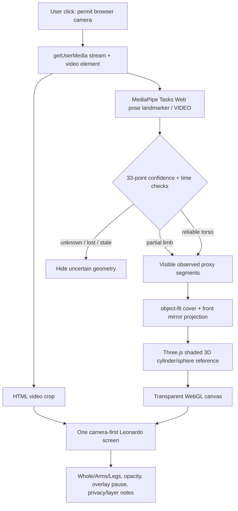
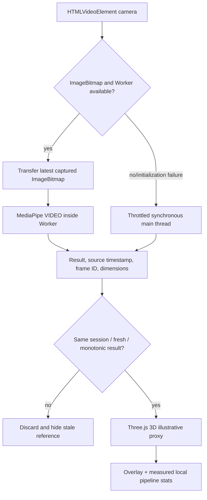

# MagicMirror Web — active architecture v0.3 (W1 runtime + W2a local model study)

**As of:** 2026-11-08. Active Web; native iOS held/frozen;
Android canceled. This is the architecture of **existing Web source**,
not a promise of a completed human anatomy AR renderer.

## Runtime data flow



`Web/src/main.ts` owns camera permission/start/stop, monotonic
video-time identity, document visibility cleanup, ~13Hz update
throttling and UI state. `Web/src/pose.ts` is a deterministic
testable confidence/visibility/crop module.
`Web/src/scene.ts` manages GPU mesh creation, reuse, compositing
and disposal. No cloud inference API or server-side camera pipeline.

**Caution:** video remains an independently advancing HTML element;
the current synchronous infer-and-draw pass does **not** guarantee
that the displayed video frame matches the one just processed,
especially if inference stalls. This is a W1 instrumentation/
frame-integrity problem; don't claim an already fixed AR registration.
The 3D proxy is rendered using 2D positions plus cosmetic depth only.
MediaPipe `worldLandmarks` alone are not camera extrinsics.

## W1 reliability pipeline (implemented source, browser QA pending)



`Web/src/inference.ts` owns model creation and dynamic worker/main
fallback; worker `Web/src/pose.worker.ts` receives a transferred
`ImageBitmap` and **must close it**. `Web/src/telemetry.ts` owns a
single-inflight, ≥75ms sampling gate and deterministic freshness
checks. No frame queue, uploads or recording are introduced.

The UI metric is **observed output results/second**, plus inference
p95 and capture-request-to-result p95. It does **not** measure camera
sensor exposure timing, browser GPU presentation or visual motion
latency. The video preview continues advancing independently.
`Web/src/snapshot.ts` builds a local PNG from the video and the
currently rendered WebGL overlay after **explicit** user interaction;
it marks the output as an illustrative proxy and never silently
saves anything.

Browser worker support depends on OffscreenCanvas, MediaPipe's
runtime assumptions and transferable ImageBitmap support; CI
typechecks, bundles the worker and runs synthetic tests but does not
execute the Worker on actual iOS Safari. Runtime fallback is
implemented. A worker failure while processing hides old results,
then tries to recover with throttled main-thread inference once.

## Development vs publication

- `Web/src`: original MIT-licensed application source.
- `Web/node_modules`: pinned npm packages, locally provisioned.
- `Web/public/wasm`: npm package-provided binary runtime staged
  locally for development; excluded from Git.
- `Web/public/models/pose_landmarker_lite.task`: exact developer
  staged Google-hosted binary (size/SHA256 pinned); excluded from Git.
- `Web/scripts/check-release.mjs` and
  `Web/release-clearance.json`: deployment safety gate;
  default unapproved due to model-weight distribution and metrics
  privacy obligations. `build:code` for CI does not waive them.
- `Mobile/iOS`: frozen, **not** a Web build/runtime dependency.
- `Unity`/`Tools`: historical algorithm and rig research only.
- `Z-Anatomy`: potential future separately licensed anatomy
  source, **not** bundled as part of current Web.

## W2a local anatomy inspection (parallel *study* only)

A user-initiated File API reads a local `.fbx` or `.glb` and
parses it in the browser through the Three.js examples loaders.
The separate `LocalAtlasViewer` renders meshes in a dedicated
modal. It is a static model explorer with an orbit camera,
real GPU model-coordinate clipping and mesh-name picking.
`Web/src/atlas-source.ts` deterministically bounds file size,
extension and coordinate-slice controls.

The camera is **stopped** before the inspector opens. Nothing about
the local mesh is added to `Web/public/`, Git, a production ZIP,
a remote server or the MediaPipe pose pipeline. A URL-modifying
LoadingManager rejects external model-supplied resource fetches and
replaces any missing image with a local 1x1 placeholder. The user
selects their file and retains responsibility for its source rights.

The viewer reports its actual number of mesh objects, triangles,
skinned meshes and authored bone UUIDs. A raw Z-Anatomy FBX
which lacks skinning weights can be viewed **statically**, but cannot
move with the user until a separately reviewed rig is created.
The X/Y/Z planes are in **model frame only**; a correct anatomical
frame still needs a human review. No real 3D anatomy overlay has
been shipped with this source.
 
## Future reviewed atlas pipeline

```text
Per-original-mesh source / author / license evidence
  -> exclude NC/unknown and review CC BY-SA reuse terms
  -> Blender human-reviewed joint hierarchy + coherent rig/skin weights
  -> geometry optimization + recorded source mapping
  -> independently calibrated camera/atlas registration
  -> browser-renderable signed or hashed model package
  -> separate attribution, modifications and lawful downloadable derivative
  -> Web renderer with explicit rights, motion and occlusion gates
```

Source author rights **do not vanish** by converting an FBX to GLB,
switching from App Store to Web or open-sourcing application code.
The installed iOS rights gates in Draft PRs #51–#53 remain reference
work and are not claimed to be merged into Web.

## Interactive educational reference notes (W4a)

The active procedural overlay stores only the **actually drawn**
screen-space segments (with visibility/confidence gating).
`Web/src/picking.ts` resolves a user click to the nearest valid
reference segment, never a hidden or invented joint. A small
Leonardo-style card draws original bilingual educational text
from `Web/src/education.ts`; the source values are general
anatomical facts, not medical/individual measurement.
A lost/stale pose or stopped camera discards hit geometry and notes.
Local model-study mesh picking is a separate path and never silently
claims that a generic segment is a Z-Anatomy source component.

## W1b procedural display smoothing

`Web/src/smoothing.ts` is an **optional screen-space visual**
low-pass filter downstream of the Worker/main inference pipeline.
It receives only confidence-accepted 33-point observations,
preserves current visibility/presence, never estimates invisible
joints, and resets after stale/invalid/dropped camera sessions.
It does not filter source video nor claim world-space anatomical
camera registration. An impossible abrupt jump hides that keypoint
for one frame and then reacquires; the Layers folio can disable
this **visual-only** processing. Tests are synthetic.
