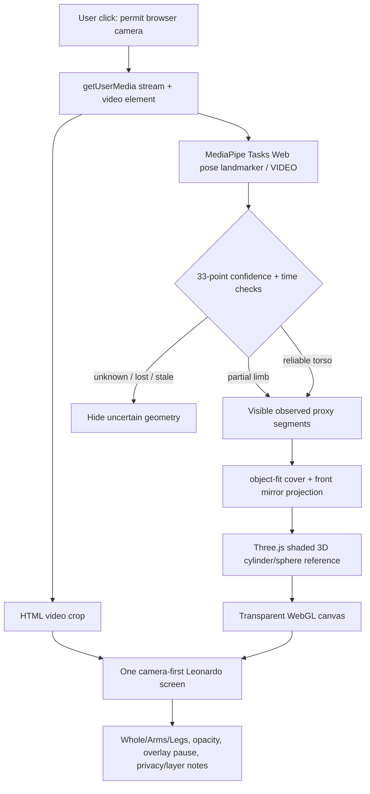
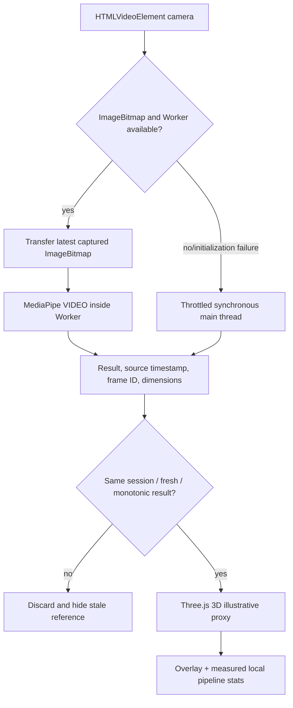

# MagicMirror Web — active architecture v0.3 (W1 runtime + W2a local model study)

**As of:** 2026-11-08. Active Web; native iOS held/frozen;
Android canceled. This is the architecture of **existing Web source**,
not a promise of a completed human anatomy AR renderer.

## Runtime data flow



`Web/src/main.ts` owns camera permission/start/stop, monotonic
video-time identity, document visibility cleanup, ~13Hz update
throttling and UI state. `Web/src/pose.ts` is a deterministic
testable confidence/visibility/crop module.
`Web/src/scene.ts` manages GPU mesh creation, reuse, compositing
and disposal. No cloud inference API or server-side camera pipeline.

**Caution:** video remains an independently advancing HTML element;
the current synchronous infer-and-draw pass does **not** guarantee
that the displayed video frame matches the one just processed,
especially if inference stalls. This is a W1 instrumentation/
frame-integrity problem; don't claim an already fixed AR registration.
The 3D proxy is rendered using 2D positions plus cosmetic depth only.
MediaPipe `worldLandmarks` alone are not camera extrinsics.

## W1 reliability pipeline (implemented source, browser QA pending)



`Web/src/inference.ts` owns model creation and dynamic worker/main
fallback; worker `Web/src/pose.worker.ts` receives a transferred
`ImageBitmap` and **must close it**. `Web/src/telemetry.ts` owns a
single-inflight, ≥75ms sampling gate and deterministic freshness
checks. No frame queue, uploads or recording are introduced.

The UI metric is **observed output results/second**, plus inference
p95 and capture-request-to-result p95. It does **not** measure camera
sensor exposure timing, browser GPU presentation or visual motion
latency. The video preview continues advancing independently.
`Web/src/snapshot.ts` builds a local PNG from the video and the
currently rendered WebGL overlay after **explicit** user interaction;
it marks the output as an illustrative proxy and never silently
saves anything.

Browser worker support depends on OffscreenCanvas, MediaPipe's
runtime assumptions and transferable ImageBitmap support; CI
typechecks, bundles the worker and runs synthetic tests but does not
execute the Worker on actual iOS Safari. Runtime fallback is
implemented. A worker failure while processing hides old results,
then tries to recover with throttled main-thread inference once.

## Development vs publication

- `Web/src`: original MIT-licensed application source.
- `Web/node_modules`: pinned npm packages, locally provisioned.
- `Web/public/wasm`: npm package-provided binary runtime staged
  locally for development; excluded from Git.
- `Web/public/models/pose_landmarker_lite.task`: exact developer
  staged Google-hosted binary (size/SHA256 pinned); excluded from Git.
- `Web/scripts/check-release.mjs` and
  `Web/release-clearance.json`: deployment safety gate;
  default unapproved due to model-weight distribution and metrics
  privacy obligations. `build:code` for CI does not waive them.
- `Mobile/iOS`: frozen, **not** a Web build/runtime dependency.
- `Unity`/`Tools`: historical algorithm and rig research only.
- `Z-Anatomy`: potential future separately licensed anatomy
  source, **not** bundled as part of current Web.

## W2a local anatomy inspection (parallel *study* only)

A user-initiated File API reads a local `.fbx` or `.glb` and
parses it in the browser through the Three.js examples loaders.
The separate `LocalAtlasViewer` renders meshes in a dedicated
modal. It is a static model explorer with an orbit camera,
real GPU model-coordinate clipping and mesh-name picking.
`Web/src/atlas-source.ts` deterministically bounds file size,
extension and coordinate-slice controls.

The camera is **stopped** before the inspector opens. Nothing about
the local mesh is added to `Web/public/`, Git, a production ZIP,
a remote server or the MediaPipe pose pipeline. A URL-modifying
LoadingManager rejects external model-supplied resource fetches and
replaces any missing image with a local 1x1 placeholder. The user
selects their file and retains responsibility for its source rights.

The viewer reports its actual number of mesh objects, triangles,
skinned meshes and authored bone UUIDs. A raw Z-Anatomy FBX
which lacks skinning weights can be viewed **statically**, but cannot
move with the user until a separately reviewed rig is created.
The X/Y/Z planes are in **model frame only**; a correct anatomical
frame still needs a human review. No real 3D anatomy overlay has
been shipped with this source.
 
## Future reviewed atlas pipeline

```text
Per-original-mesh source / author / license evidence
  -> exclude NC/unknown and review CC BY-SA reuse terms
  -> Blender human-reviewed joint hierarchy + coherent rig/skin weights
  -> geometry optimization + recorded source mapping
  -> independently calibrated camera/atlas registration
  -> browser-renderable signed or hashed model package
  -> separate attribution, modifications and lawful downloadable derivative
  -> Web renderer with explicit rights, motion and occlusion gates
```

Source author rights **do not vanish** by converting an FBX to GLB,
switching from App Store to Web or open-sourcing application code.
The installed iOS rights gates in Draft PRs #51–#53 remain reference
work and are not claimed to be merged into Web.

## Interactive educational reference notes (W4a)

The active procedural overlay stores only the **actually drawn**
screen-space segments (with visibility/confidence gating).
`Web/src/picking.ts` resolves a user click to the nearest valid
reference segment, never a hidden or invented joint. A small
Leonardo-style card draws original bilingual educational text
from `Web/src/education.ts`; the source values are general
anatomical facts, not medical/individual measurement.
A lost/stale pose or stopped camera discards hit geometry and notes.
Local model-study mesh picking is a separate path and never silently
claims that a generic segment is a Z-Anatomy source component.

## W1b procedural display smoothing

`Web/src/smoothing.ts` is an **optional screen-space visual**
low-pass filter downstream of the Worker/main inference pipeline.
It receives only confidence-accepted 33-point observations,
preserves current visibility/presence, never estimates invisible
joints, and resets after stale/invalid/dropped camera sessions.
It does not filter source video nor claim world-space anatomical
camera registration. An impossible abrupt jump hides that keypoint
for one frame and then reacquires; the Layers folio can disable
this **visual-only** processing. Tests are synthetic.

## W4b local language presentation

`Web/src/i18n.ts` contains a curated local CN/EN dictionary,
lightweight DOM text/accessible-label presentation and a
nonpersistent switch. `main.ts` preserves raw camera state
messages and re-renders them on locale changes without creating
or restarting a MediaPipe/camera session. The real anatomical
source filename and per-mesh provenance remain original
strings rather than being auto-translated by an external API.
This is browser UI localization, not medical terminology QA.

## W2b source anatomy part browser and export

`Web/src/atlas-viewer.ts` now retains a local in-memory index of
*real parsed* mesh objects, source hierarchy paths, triangle
counts, per-mesh visibility and a temporary isolation selection.
The Web scene can change mesh visibility, focus the actual mesh
bounding box and highlight a chosen object in the static viewer.
`Web/src/atlas-catalog.ts` provides pure, tested, NFKC/case-
normalized name/path filtering with capped result rendering,
without assigning medical semantics or interpreting imported
names as HTML. The visible list uses `textContent` to prevent
source-filename markup insertion.

After the user explicitly selects a local file, SHA-256 is computed
over its original ArrayBuffer in a secure-context browser and
retained in memory with file size and actual mesh/triangle/skinning
counts. `Web/src/atlas-inventory.ts` builds a purely informational
`schemaVersion=1` local downloadable JSON with every source
mesh hierarchy path. It includes **NO original geometry**, and
each component has `commercialReuseReviewed=false` and
`licenseEvidence=null`; the complete inventory is
`rightsStatus=NOT_REVIEWED`. It cannot serve as clearance for
publishing those Z-Anatomy/BodyParts3D meshes, a medical source
or a rigged AR atlas. No export occurs without a user click.

The study model limits remain ≤75 MB selected file, ≤2,000,000
triangles and ≤5,000 source meshes; large input may still impose
significant in-memory parsing costs, so actual device profiling
is an open acceptance requirement.

## W2c rig diagnostics and animation study pipeline

`Web/src/rig-diagnostics.ts` performs pure, bounded sample-level
checks on **real imported** `skinWeight` and `skinIndex`
attributes from a user-selected FBX/GLB `SkinnedMesh`.
These are reported in the separate **static Folio II** along
with actual authored skeleton joint and skinned-mesh counts.
The local source inventory exports the sampling counts with
`samplingOnly=true` and independently keeps
`rightsStatus=NOT_REVIEWED`; it is not a license, a complete
weight audit or a clinical correctness result.

FBXLoader's source `object.animations` and GLTFLoader's
`gltf.animations` are inspected as source-authored
`AnimationClip` objects. Safe, previewable clips are limited
to the first 40 candidates, with individual duration at most
600 seconds and track count at most 10,000. The user must
explicitly select/play these clips. Three.js AnimationMixer
updates only the **local static study model** in a bounded
requestAnimationFrame loop; close/pause/replace cleans up actions.
No animation data is inferred from camera landmarks, sent to
a server or shipped as a licensed asset.

This does **NOT** change the separate camera pipeline:
MediaPipe's live procedural proxy still follows 2D observed
surface points, without a reviewed Z-Anatomy skinning rig.

## W2d editable, source-hash-bound mesh-to-segment mapping

`Web/src/atlas-mapping.ts` defines 12 *existing, observed*
MediaPipe shoulder/elbow/wrist/hip/knee/ankle and torso segment
pairs. The Folio II **static** source part browser lets a user
manually annotate each actual imported mesh with a coarse
`PoseSegmentId`; no automatic Z-Anatomy bone classifier is
used or implied. The user can explicitly download or select
a local mapping JSON containing **no mesh geometry**.

Every draft is bound to the current original source file's
SHA-256, byte size and real original mesh metadata. Incoming
JSON is strongly schema validated and must still declare
`USER_DRAFT_UNCALIBRATED`, `sourceCoordinateFrame=UNVERIFIED`,
`retargetingStatus=NOT_READY`, and
`commercialReuseStatus=NOT_REVIEWED`. Unknown fields, fake
review approvals, duplicate mesh IDs, altered hierarchy paths,
and different original source files reject the import entirely.
Nothing is automatically transmitted to a server, written to
browser storage, or distributed with the Web bundle.

This maps an *artist/researcher hypothesis* of which parts
belong near an **observed surface segment**. It is NOT a
kinematic hierarchy, skinning, real joint-local orientation,
3D rest-pose calibration, verified physical bone position,
rights evidence, camera registration or animated AR model.

## W2e explicit original-root point authoring

Folio II uses the same Three.js source mesh raycaster to
select two **user-clicked** original model-space reference
points per explicitly mapped source mesh. The user
chooses an endpoint, then clicks *that same source mesh*;
hits on different objects cannot mark it. Each
`hit.point` (world space) is converted with the
imported source root's `worldToLocal()`, recording
original-root local coordinates rather than normalized
renderer positions. Real model asset file origin and
rest pose remain unvalidated; paused authored animations
can still have non-rest transforms, so these points are
**not** a certified joint or model rig.

`Web/src/atlas-anchors.ts` validates original source
file SHA-256, byte size, mesh name/path/count/triangle
identity, exact current W2d segment mapping and
distinct finite source-space endpoint coordinates.
Every accepted JSON must state uncalibrated,
unretargeted, original-frame-unverified and
NOT_REVIEWED licensing, with no forged approval fields.
Only the explicit user click downloads this JSON;
it contains no mesh vertices, camera frames,
source asset bytes or automatic recording.
A changed mapping or model invalidates stale points,
and importing another model's JSON fails closed.

## W2f source-space single rigid part experiment

The PRIVATE Folio II now supports a reversible source-mesh
rotation experiment. After a human chooses an actual imported
`Mesh` (never a `SkinnedMesh`), manually provides a
surface-segment mapping and A/B source-root positions,
`Web/src/rigid-preview.ts` computes a rigid 4×4 source
matrix around **A** using an explicitly chosen source
X/Y/Z axis. It bounds the angle to ±90° and rejects
nonfinite/singular frames, missing/overlapping points
and unrecognized axes.

On each slider update, the original mesh's immutable
baseline WORLD matrix is transformed in the imported
original-root frame, then converted back into the actual
mesh-parent frame; the Three.js object uses a reversible
`matrixAutoUpdate=false` preview matrix. No geometry,
weights, material or original source file are changed.
The user can restore the exact original matrix/auto-update
setting; changing selected mesh, hiding the part, replacing
source, or closing the dialog also restores the original.
The B reference marker moves along with the rigid
reference end; A remains the pivot.

A model containing any previewable source animation clips
or a selected `SkinnedMesh` is rejected deliberately;
the experiment does not mix with authored AnimationMixer
motion. This is not a articulated/weighted anatomical
rig, not an anatomically verified bone hinge, not a
person-specific camera transform or patient X-ray.
The public model rights and SDK privacy release gates
remain unchanged and unapproved.


## W2g virtual KINEMATIC STUDY graph, not a real anatomical rig

`Web/src/kinematic-chain.ts` holds a testable bounded
manual DAG of SOURCE mesh IDs, original model-local A/B
points, explicit parent source IDs, X/Y/Z model axes
and angle values. It validates graph structure and
topologically propagates parent SOURCE-root transforms:
`D_child_total = D_parent_total * T(A_child) *
R_local(axis,angle) * T(-A_child)`.
The source remains unverified for real joint placement
or anatomy classification. No MediaPipe observations enter
this module.

`LocalAtlasViewer.beginChainPreview` leaves every original
Mesh untouched, creates at most twelve temporary gold
wireframe ghost meshes reusing geometry, stores immutable
source mesh WORLD matrices, and applies
`M_ghost = RootWorld * D_total * inverse(RootWorld) * M_source_original`.
A child ghost follows its parent transform without modifying
the original imported hierarchy, skins, material or
any underlying FBX/GLB asset. All chain errors are fail
closed; changing model/mapping/anchor or closing the dialog
tears down the transient ghost study. The explicit
per-mesh parent editor and slider are in Folio II.

This is a local, ORIGINAL-model coordinate preview.
No camera extrinsics, 3D pose identity, bone proportions,
medical skeletal joint axes, retarget weights or
redistribution rights have been reviewed.


## W2h original GLB demonstration as an onboarding/QA fixture

`Web/src/study-demo.ts` owns three original MIT-app
thin 3D box meshes and explicit sample geometry
positions, manually-authored A/B reference endpoints,
source mesh identifiers and a 3-node virtual chain.
On explicit user interaction, the Three.js
GLTFExporter serializes the generated scene as
a self-contained in-memory GLB `File`. The app
routes that file through the SAME local GLTFLoader,
original source SHA-256 generation, part inspection,
mapping, point annotations and W2g wireframe ghost
viewer as a user-provided file. No third-party
mesh, body data, original anatomical source or
network resource is included in the fixture.

This is an internal original 3D spatial/math
demo, **NOT** a medical anatomical model,
a MediaPipe tracking demonstration, an auto-rigger
or confirmation that the Z-Anatomy FBX works
with skinning/animation. The tutorial helps
reviewers exercise the UI without needing to
acquire restricted source assets first.


## W2i offline source-keyframe playback engine

`Web/src/study-timeline.ts` is the pure, bounded,
camera-free angle timeline: up to 32 manually
selected source-angle frames across 0–10 s,
original source/root graph SHA + mesh identity,
per-node fixed axes and ±90° angles. Interpolation
is deterministic and linear, with a neutral
first/last hold outside the authored interval.
Imported JSON MUST match original model SHA-256,
file size, mesh count, exact W2g manually authored
parent graph and W2e source anchor coordinates.
All source model rights/retarget states stay
NOT_REVIEWED/not calibrated.

The Folio II user can capture keyframes at a
time slider, delete/clear, import/export local
JSON and explicitly Play/Pause a loop.
`LocalAtlasViewer.setChainPose` applies all
joint values to 2–12 separate THREE.js ghost
meshes in one update pass; original source
geometry and camera frames remain untouched.
The finite requestAnimationFrame loop stops
on hidden document, study modal close or
source mapping change. No cloud or auto
recording, author bone-weight change,
physical 3D camera calibration, real
human pose animation or public model
distribution is authorized by these frames.


## W2j opt-in actual browser smoke environment

`Web/playwright.config.ts` starts the unmodified Vite
development server at `localhost:5173`; headless Chromium
with a software WebGL renderer opens the same DOM and lazy
Three.js source loader as a regular end-user.
`Web/tests/browser/original-demo.spec.ts` uses the
original THREE.js generated GLB from `study-demo.ts`,
rather than any actual third-party anatomical FBX
or Google task model. It exercises page state,
source GLB parsing, virtual ghost preview, timeline
loop, user-initiated JSON download and rejection
of falsified model SHA, entirely without a camera
request. This validates selected browser integration
behavior, NOT a certified anatomical visualization,
mobile Safari, actual source performance, live
pose tracking, medical calibration or distribution
rights.

The existing `.github/workflows/web-mvp.yml`
runs fast source/unit tests on ordinary Web
changes. Its extra Chromium job is opt-in for
manual workflow runs or PR branches with
`browser-smoke` in the name. The source build
and public release guard stay unchanged.

## W2k browser engine and phone-viewport regression coverage

The opt-in browser job in the existing Web workflow
now installs pinned Playwright Chromium AND WebKit on
Ubuntu 24.04. The exact same `original-demo.spec.ts`
runs in two projects: real desktop Chromium with software
WebGL and Linux WebKit using iPhone 13 mobile viewport
and touch emulation. 6 of 6 E2E checks completed on
GitHub-hosted Actions (2026-11-09, run 42652358053).
It exercises a real browser engine in place of a
pure mathematical unit test, without any camera
permissions, third-party meshes or model weights.

Linux WebKit/iPhone viewport emulation does not have
the same OS sandbox, media devices, graphics/thermal
stack or actual screen orientation as hardware
Apple Safari. Physical Safari remains W0 acceptance
work; this result must not unlock model-weight
redistribution, camera-to-bone 3D registration,
Z-Anatomy rig validity or public hosting.


## W2l one-file local study session and replay diagnostics

`Web/src/study-session.ts` composes the already validated
`AtlasMappingDraft`, `AtlasAnchorDraft`, an ordered bounded W2g
`StudyChainNode[]` and an optional `StudyTimelineDraft` into a single
`magicmirror-local-study-session` document. `makeStudySession` only
serializes a state whose chain A/B points are byte-identical to the
validated anchor draft; `parseStudySession` calls
`parseDraftMapping`, `parseAnchorDraft`, `orderStudyChain` and
`parseStudyTimelineDraft` in that order and returns nothing unless
EVERY check passes. No source geometry, camera frames, clip data or
rights approval is written; no `localStorage`, network request or
automatic download is used. An early mapping/anchor-only state is
allowed with an empty chain and `timeline: null`.

Folio II exposes explicit Export/Import controls. The import handler
first checks that every restored chain mesh is still a visible,
non-skinned, unanimated source part via
`LocalAtlasViewer.canRigidPreview`, then replaces mappings, anchors,
chain IDs/parents/angles and keyframes in ONE batch. It deliberately
does NOT restart the ghost preview, animation mixer, webcam or
keyframe loop; the user must click Preview virtual chain again.
Loading a different model invalidates the previous session status,
and the 中文 / EN switch keeps the panel, status and diagnostics
aligned through locally bundled copy.

`studyReplayDiagnostics` samples every authored keyframe and each
interpolation midpoint, recomputes `studyChainDeltas` twice from the
immutable authored rest nodes, and compares all 16 matrix elements
of each node, including a full-sequence restart back to frame 0.
`deterministic` is true only when the maximum absolute difference is
exactly zero. The report is labelled
`SYNTHETIC_SOURCE_MATRIX_REPLAY_ONLY`: it is a numerical
reproducibility check, not anatomical accuracy, camera calibration,
WebGL runtime correctness, GPU budget or device QA. Public model
distribution and real body-to-mesh AR remain separately gated.


## W1c worker result gate and fail-closed fallback

`Web/src/inference-result.ts` is a pure decision function placed BETWEEN
the Worker message boundary and the renderer. `decideWorkerMessage`
receives the immutable engine snapshot (`closed`, `ready`,
`recovering`, `mode`, `workerAlive`, `pendingFrameId`,
`currentSession`) plus the message and returns `accept`, `ignore` or
`fatal`. `accept` requires a live worker, an unconsumed in-flight
frame id, an exact camera-session match and finite, plausible timing,
dimensions, inference cost and at most 33 finite landmark points;
`null` landmarks are the only honest "no pose" payload. `ignore`
covers closed/recovering sessions, stale or duplicate frames, replaced
camera sessions, unknown payloads, malformed STALE results and late
fatals from terminated workers. A malformed CURRENT result returns
`fatal`, which fails the worker closed. `workerFailureText` exposes
only local error strings, never image or pose data.

`Web/src/inference.ts` now consumes that gate for both `message` and
`error` events. `fail()` and `close()` synchronously set
`pendingFrameId = 0` and `currentSession = -1`, terminate the worker,
clear the 2s stall timer and call `gate.settle()` rather than
`gate.reset()`: the frame sequence stays monotonic so the viewer's
`lastReceivedFrameId` guard still accepts main-thread fallback frames.
The once-only recovery builds a throttled main-thread `PoseLandmarker`
without drawing anything from the dead worker; a second failure on
the main path calls `onFatal`. `postBitmap` revalidates mode,
recovery, frame id and session after `await createImageBitmap(...)`
and closes an abandoned bitmap. A rejection of the boot promise from
`close()` propagates instead of starting a local model.

`Web/src/inference-result.test.ts` and `Web/src/inference.test.ts` are
synthetic: fake Worker, fake `createImageBitmap`, fake `OffscreenCanvas`
and a mocked `@mediapipe/tasks-vision`. The Web CI build step also
asserts that `vite build` emits a `pose.worker-*.js` chunk containing
`detectForVideo`. None of this executes WASM, a real ImageBitmap
transfer, WebGL or Safari; it is a compilation/state-machine check, not
a latency, camera-quality or hardware acceptance result.


## W3a live rig: pure gate -> original hierarchy -> shared overlay host

W3a adds ONE opt-in overlay mode without changing the camera or inference
pipeline. `Web/src/inference.ts` is untouched: `LivePoseInference` still
owns the single `getUserMedia` stream, the latest-only frame budget, worker
inference and the main-thread fallback. `Web/src/main.ts` remains the
orchestrator (camera session, mode selection and status text); it holds no
rig math and no per-frame Three.js transform state.

### Data flow (one inference frame)

```text
video -> LivePoseInference -> InferenceFrame (33 landmarks | null)
  -> main.ts handlePoseFrame(): frameId / session / freshResult guard
  -> LiveRigOverlay.apply(frame, RigFrameContext)
       -> LiveRigTracker.update(RigObservation)
            -> computeRigFrame()  [PURE]
                 mapImageToViewport(cover + mirror), usable(confidence)
                 upper arm: absolute atan2(dy, dx)
                 forearm: shortestAngleDelta(parentAngle, foreAngle)
                 guards: finite meta, 33 finite landmarks, legs rejection,
                         degenerate segments, angle discontinuity, stale,
                         old session, out-of-order frame, no pose
       -> OriginalArticulatedRig.apply(frame, opacity)
            shoulderPivot -> elbowPivot -> attachedFore  [REAL hierarchy]
       -> OverlayRenderHost.render()  [EXISTING WebGLRenderer]
```

`Web/src/live-rig/pose-to-rig.ts` imports only `pose.ts` (`PosePoint`,
`Focus`, `usable`, `mapImageToViewport`) and `telemetry.ts` (`CapturedFrame`,
`freshResult`). It has no DOM, Worker, MediaPipe, camera or Three.js
dependency. MediaPipe `z` is validated as finite and NEVER used as camera
depth; the rig lives in the same object-fit:cover, mirrored DISPLAY-PIXEL
space as the W0 proxy. Anatomical left/right identity is the person's own
(11/13/15, 12/14/16); a display mirror flips x only. `focus === "legs"`
returns `REGION_NOT_SUPPORTED` rather than inventing a leg chain. When a
shoulder is not visible, the observed forearm is drawn as an INDEPENDENT
segment (`hierarchyAttached: false`, `parentRelativeRadians: null`) with no
fabricated shoulder or elbow parent.

`LiveRigTracker` owns only bounded transform history: a filtered JOINT
position map and the raw observation angle map used for discontinuity
detection. `reset()` invalidates session/frame ordering (camera stop,
restart, page hidden, flip, mode switch), `clearTransforms()` keeps ordering
but drops history (worker fallback, tracking loss, stabilization toggle,
stale result), and `pause()`/`resume()` guard overlay pause. Angle wrapping
uses `wrapRadians`/`shortestAngleDelta`; a sample farther than
`maxAngleStepRadians` from its predecessor is hidden for that frame instead
of being smoothed into a fabricated intermediate bone. Pivot interpolation
is ABSOLUTE (`previous + alpha * (current - previous)`), never accumulated,
so there is no positional drift.

**Coherent filtered-pose contract (review fix).** Stabilization is applied
to JOINT POSITIONS (shoulder / elbow / wrist), never to an angle in
isolation. Every field of the returned `RigFrame` — segment start/end,
lengthPx, angleRadians, parentRelativeRadians, hierarchyAttached,
`arms.*.elbow`/`wrist` and the torso pivot — is derived from that ONE
filtered joint set, so `OriginalArticulatedRig` reconstructs exactly the
joints the frame declares. The only difference from the raw observation is
an INTENTIONAL, BOUNDED display lag: each joint is an absolute interpolation
between the last displayed joint and the new observation, capped at
`RIG_MAX_LAG_LENGTH_RATIO` (0.25) × the shortest observed segment on that
arm. The lag decays geometrically for a stationary pose and is dropped (not
interpolated) on a camera flip, session change, pause, tracking loss, angle
discontinuity or a gap ≥ `RIG_DISCONTINUITY_WINDOW_MS`, so no intermediate
bone is invented. Discontinuity is judged in OBSERVATION space (raw angle
vs previous raw angle), not in lagged display space, so fast-but-valid
motion is not mistaken for a teleport.

**Controller fail-closed session contract (review fix).** `LiveRigOverlay`
tracks its own `contextSession`: when a NEWER authoritative camera context
arrives, the controller itself clears any previously visible stale A
geometry BEFORE any B frame is drawn — even if `main.ts` forgot to call
`reset()`. An OLDER context is a late callback and must NOT remove geometry
already accepted for B. A stale frame within the current context is rejected
without touching the already-accepted newer state.

### Three.js ownership and the single renderer

`Web/src/live-rig/original-rig.ts` is the only module that allocates
meshes: cylinder/sphere/box geometries and three shared
`MeshStandardMaterial`s. Geometry and materials are created once in the
constructor and reused; `apply()` writes ABSOLUTE positions, rotations and
scales from the immutable authored rest geometry, then calls
`updateMatrixWorld(true)`. Tests verify that the attached forearm's world
tip equals the observed wrist and that repeated absolute writes produce an
identical matrix (no cumulative rotation/position drift). `hide()` clears
every visible mesh on tracking loss; `dispose()` detaches and releases all
GPU resources.

`Web/src/scene.ts` now implements the structural `OverlayRenderHost`
interface (`attach`, `detach`, `hideProxy`, `render`, `renderForCapture`,
`viewport`). `ProxySkeletonRenderer` therefore continues to own the only
`WebGLRenderer`, `Scene` and `OrthographicCamera`; the rig's `Group` is
simply added to that scene. `LiveRigOverlay.setMode("rig")` attaches it once,
fails closed to `"proxy"` if construction throws, and never starts a second
camera stream, renderer or `requestAnimationFrame` loop. `viewport()` is the
exact orthographic display size, so the rig and proxy always share the same
projection. Explicit PNG capture still calls `renderForCapture()` once.

### Lifecycle integration in main.ts

`hideOverlay()` routes every hide to the ACTIVE mode: in rig mode it calls
`LiveRigOverlay.hide()`, which hides both the rig and the proxy through the
shared host. Stale results, missing poses, `tick()` tracking loss, overlay
pause, focus changes, stabilization changes and `stopCamera()` all use this
path; `stopCamera()` additionally calls `rigOverlay.reset()`. A detected
`runner.mode` change (worker → main fallback) calls `clearTransforms()`.
The rig path deliberately uses RAW `frame.landmarks` (the rig owns its own
bounded stabilization) while the proxy path keeps the existing
`TemporalPoseStabilizer` output, so enabling the checkbox does not
double-smooth either path. Learning-note picking stays bound to W0
independent proxy segments only.

The FBX/GLB study dialog remains isolated: opening it calls `stopCamera()`
exactly as before and sets an honest status line stating that imported
models are never camera-retargeted. No imported mesh is attached to the
live rig scene and no runtime hook accepts injected landmarks.

### Tests and their limits

- `pose-to-rig.test.ts` (31): deterministic geometry, flexion/extension,
  pivot continuity, mirror, unequal aspect ratios, partial poses,
  occlusion, confidence, nonfinite/degenerate/stale/old-session/
  out-of-order frames, pause/resume, flip, restart, fallback, toggles and
  hierarchy metadata consistency when a parent is angle-rejected.
- `motion-coherence.test.ts` (5): two consecutive moving frames → tracker
  bounded whole-pose stabilization → `OriginalArticulatedRig.apply` → real
  Three.js `getWorldPosition` / `localToWorld`. Asserts declared joints,
  segment endpoints and GPU world positions are IDENTICAL; bounds the
  display lag and verifies geometric decay without drift; covers cover/mirror
  and stabilization-disabled paths; renders a surviving forearm independently
  when its parent is rejected.
- `original-rig.test.ts` (12): hierarchy/wrist-tip continuity, parent-
  relative rotation, no drift, geometry/material reuse, one-arm loss,
  independent forearm, hide/dispose and opacity clamping. No WebGL context.
- `rig-controller.test.ts` (9): default proxy, single attach, session
  rejection, **A→B stale geometry clearing**, **late A frame cannot remove B**,
  pause/hide/reset, dispose and fallback ordering with a fake structural host.
- `tests/browser/live-original-rig.spec.ts` (3 tests × 2 engines): opt-in
  Chromium + iPhone-sized WebKit ENGINE emulation. Test-only dynamic source
  imports inside `page.evaluate` drive deterministic 33-point fixtures; the
  production bundle has no injection hook. Camera stays off, one stage
  canvas, no MediaPipe weights or third-party meshes. The third test mounts
  the rig through the REAL `ProxySkeletonRenderer` (shared WebGL host),
  feeds two consecutive frames and asserts the shared renderer actually
  produced readable pixels and coherent world joints.

These prove source correctness, numerical reproducibility and real browser
engine integration for the ORIGINAL screen-aligned rig. They do NOT prove
camera-space 3D registration, anatomical accuracy, skinning, model rights,
SDK privacy clearance, physical iPhone Safari acceptance or public release.
`Web/release-clearance.json` remains `releaseApproved: false`.

## W3b: world-landmark transport and local 2D consistency

MediaPipe's model-estimated hip-centered 33-point `worldLandmarks`
(often described in meters in SDK documentation) are collected from the
SAME `detectForVideo` result as the image landmarks. The existing
one-in-flight Worker and main fallback only pass bounded numeric arrays
under the existing frame/session/timing identity. Missing world data
keeps 2D pose usable; malformed present worker data fails closed.

`Web/src/world-pose.ts` compares up to 12 paired 2D/world points and
fits a weighted in-plane similarity to actual viewport coordinates after
cover crop and mirror. This ignores predicted world Z. A low residual
is only 2D consistency, **not** camera extrinsics or anatomical truth.
`main.ts` presents a bilingual readout inside collapsed diagnostics,
never applies the fit to the live rig, stores/export points or opens
real atlas layers.

See [W3B_WORLD_OBSERVATION.md](W3B_WORLD_OBSERVATION.md).
